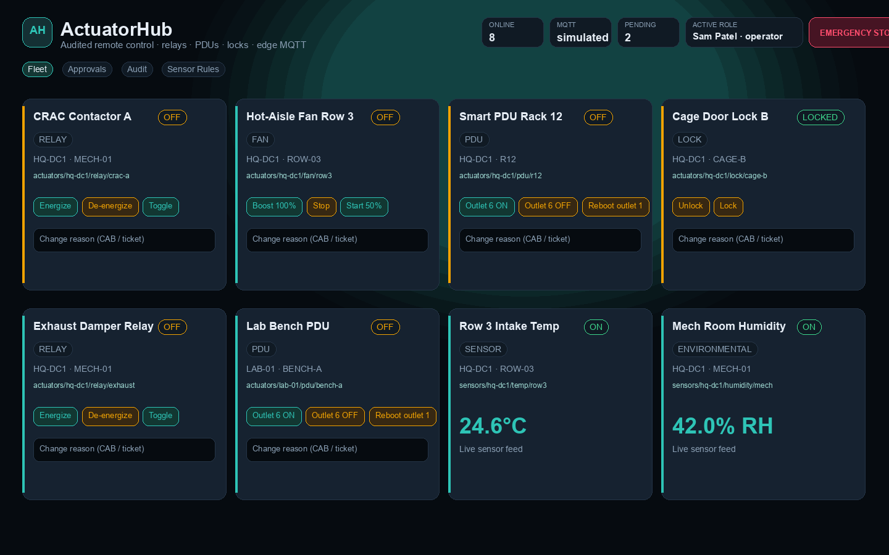
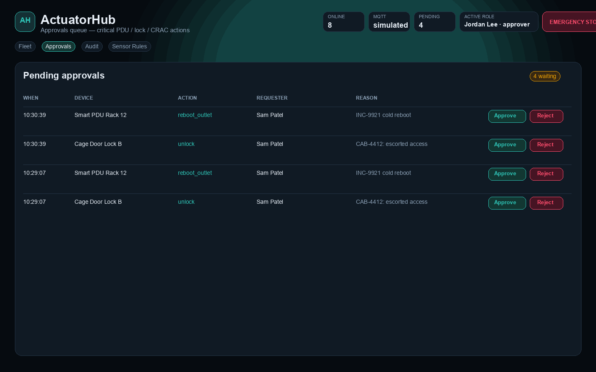
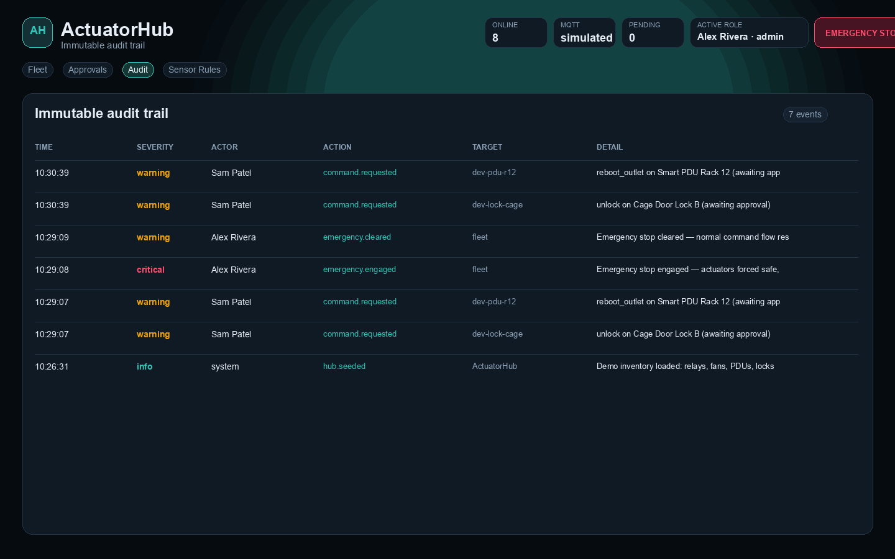
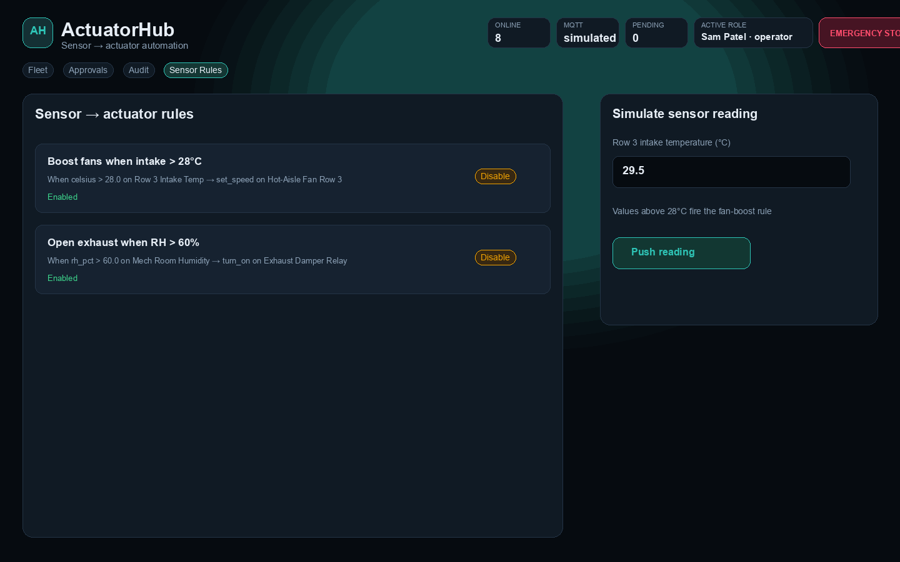
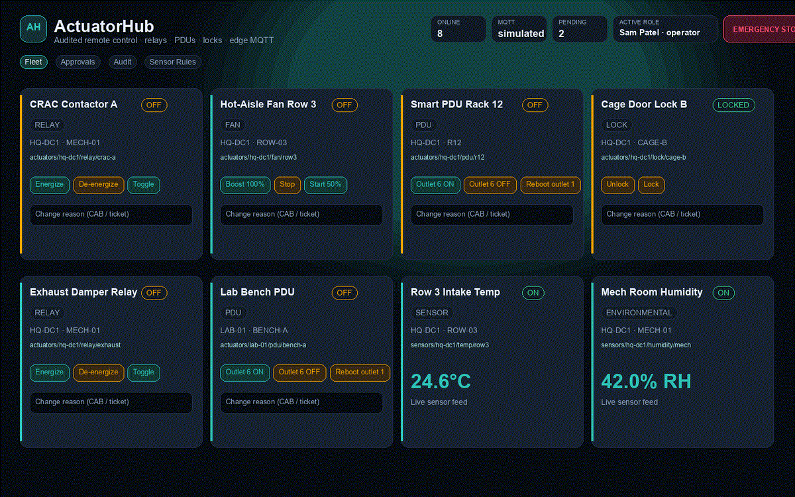

# ActuatorHub

**Audited, role-based remote control of physical actuators, relays, smart PDUs, and environmental devices via Raspberry Pi and Arduino.**

A free alternative to commercial facility-control and intelligent-PDU platforms. Issue commands from a glass console, route critical actions through approval workflows, keep a full audit trail, trip a fleet-wide emergency stop, and wire sensor thresholds to actuators over MQTT.

Built for IT / data-center / lab teams who already own Pi and Arduino hardware — FastAPI + React + MQTT + Docker + edge agents.

## Screenshots

| View | Preview |
|------|---------|
| Fleet console |  |
| Approval workflow |  |
| Audit trail |  |
| Sensor rules |  |

<p align="center">
  
</p>

## What it does

| Feature | Purpose |
|---------|---------|
| **Fleet console** | Live view of relays, fans, smart PDUs, locks, and environmental sensors |
| **Role-based access** | Viewer / operator / approver / admin with ranked permissions |
| **Approval workflows** | Critical PDU, lock, and CRAC actions wait for approver/admin before dispatch |
| **Full audit log** | Every request, decision, dispatch, rule fire, and E-stop is recorded |
| **Emergency stop** | One click forces actuators safe and blocks new commands until cleared |
| **Sensor triggers** | Threshold rules (temp, humidity, …) auto-command target actuators |
| **MQTT edge bridge** | Live broker when available; simulated mode for demo without hardware |
| **Pi + Arduino agents** | Python GPIO agent and ESP32 lock sketch included |

## Architecture

```
┌─────────────┐     REST      ┌──────────────┐     MQTT      ┌────────────────┐
│ React console│ ───────────► │ FastAPI hub  │ ────────────► │ Mosquitto      │
│ (Vite)       │ ◄─────────── │ + audit store│ ◄──────────── │                │
└─────────────┘               └──────────────┘               └───────┬────────┘
                                                                     │
                                              ┌──────────────────────┼──────────────┐
                                              ▼                      ▼              ▼
                                        Pi edge agent          Arduino lock     Sensors
                                        (GPIO / SIM)           (Wi-Fi MQTT)
```

## Run

### Frontend + API (demo — no broker required)

```bash
git clone https://github.com/btstevens1984az/ActuatorHub.git
cd ActuatorHub

# terminal 1 — API
cd backend
python3 -m venv .venv
source .venv/bin/activate   # Windows: .venv\Scripts\activate
pip install -r requirements.txt
PYTHONPATH=. uvicorn app.main:app --reload --port 8788

# terminal 2 — UI
cd frontend
npm install
npm run dev
```

Open http://localhost:5173  
API docs: http://127.0.0.1:8788/docs

Demo roles are in the top-right selector (`Sam Patel · operator`, `Jordan Lee · approver`, …). MQTT runs in **simulated** mode until a broker is reachable.

### Docker (API + Mosquitto + static UI)

```bash
docker compose up --build
```

Open http://localhost:8788

### Edge agents

**Raspberry Pi**

```bash
cd edge/pi_agent
pip install -r requirements.txt
MQTT_HOST=your-broker ACTUATORHUB_SIM=1 python agent.py
# On real GPIO hardware: ACTUATORHUB_SIM=0
```

**Arduino / ESP32 lock** — flash `edge/arduino/actuatorhub_lock.ino` (PubSubClient + ArduinoJson), set Wi-Fi / MQTT / site / lock name.

### Linux

```bash
git clone https://github.com/btstevens1984az/ActuatorHub.git
cd ActuatorHub/backend && python3 -m venv .venv && source .venv/bin/activate
pip install -r requirements.txt
PYTHONPATH=. uvicorn app.main:app --reload --port 8788
```

### Windows

```powershell
git clone https://github.com/btstevens1984az/ActuatorHub.git
cd ActuatorHub\backend
python -m venv .venv
.\.venv\Scripts\activate
pip install -r requirements.txt
$env:PYTHONPATH="."
uvicorn app.main:app --reload --port 8788
```

### macOS

```bash
git clone https://github.com/btstevens1984az/ActuatorHub.git
cd ActuatorHub/frontend
npm install
npm run dev
open http://localhost:5173
```

## Project structure

```
ActuatorHub/
├── frontend/                 # React + TypeScript + Tailwind (Vite)
│   └── src/
│       ├── App.tsx           # Fleet / Approvals / Audit / Rules console
│       └── lib/api.ts
├── backend/                  # FastAPI control plane
│   └── app/
│       ├── main.py           # REST API
│       ├── services.py       # Commands, approvals, E-stop, rules
│       ├── mqtt_bridge.py    # Live + simulated MQTT
│       └── seed.py           # Demo fleet inventory
├── edge/
│   ├── pi_agent/             # Raspberry Pi MQTT → GPIO agent
│   └── arduino/              # ESP32 lock sketch
├── docker/                   # Mosquitto config
├── media/                    # Screenshots + GIF
├── scripts/                  # Media capture / generation
├── docker-compose.yml
└── README.md
```

## Roles & safety model

| Role | Can view | Can command | Can approve | Can E-stop |
|------|----------|-------------|-------------|------------|
| viewer | ✓ | | | |
| operator | ✓ | ✓ (non-critical immediate) | | ✓ |
| approver | ✓ | ✓ | ✓ | ✓ |
| admin | ✓ | ✓ | ✓ | ✓ |

Critical actions on approval-flagged devices (`turn_off`, `unlock`/`lock`, PDU outlet off/reboot) enter the **Approvals** queue. Emergency stop overrides the fleet to a safe state and rejects new commands until cleared.

## Capture media locally

With the UI on http://127.0.0.1:5173 and API on :8788:

```bash
# Playwright tour (requires chromium)
npm install
npx playwright install chromium
npm run capture

# Or API-driven PNG/GIF generator (Pillow + ffmpeg)
python scripts/generate-media.py
```

## Security & privacy

- Demo auth uses the `X-User-Id` header — replace with SSO / OIDC before production
- Audit events stay in-process for the demo store; wire to your SIEM / append-only log for real sites
- Edge agents should use authenticated MQTT (TLS + credentials) on production brokers
- Physical safety: fail-secure locks, E-stop wiring, and change tickets remain your operational controls — ActuatorHub orchestrates, it does not replace site safety policy

## License

MIT
